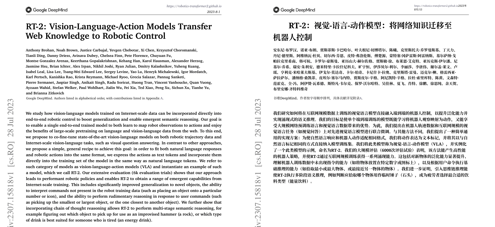

# Paper Translator

[中文](README.zh-CN.md)

A self-hosted web app that translates academic PDFs into Simplified Chinese while keeping the original layout. Upload a paper, pick a page range, and get a translated-only PDF and a side-by-side bilingual PDF you can preview in the browser and download. Images (posters, figures, screenshots) can be translated too, using a vision model.

It wraps [BabelDOC](https://github.com/funstory-ai/BabelDOC) with what a long-running service needs: a persistent task queue, chunked processing that resumes after failures, memory protection on small servers, OCR for scanned pages, and advisory warnings for paragraphs that remain untranslated. It was extracted from a personal site where it has been translating real papers on a 2 vCPU / 4 GB server; accounts and billing were removed for this release.

The interface is in Chinese.



*Bilingual PDF from a production run on RT-2 ([arXiv:2307.15818](https://arxiv.org/abs/2307.15818), © 2023 Google DeepMind), cropped. More examples, measured speed and memory, and the problems hit in production are in [Production notes](docs/production-notes.md).*

## Features

- **Layout-preserving PDF translation.** BabelDOC rebuilds each page with the translation in place. You get `translated.pdf` and `bilingual.pdf`, a page-by-page preview, and a plain-text export.
- **Long papers.** Pages are translated in small chunks that are cached on disk. If a run fails or the server restarts, finished chunks are reused and the job continues where it stopped. Narrowing the page range later does not throw away completed pages.
- **Memory protection.** On Linux the service watches cgroup memory, available RAM and swap. Under pressure it stops BabelDOC, waits for memory to recover and retries at lower concurrency, falling back to one page at a time if needed.
- **Best-effort translation.** Truncated or empty answers are retried with larger output budgets. Paragraphs that still fail keep their original text, and the PDF remains downloadable with a warning listing the affected pages.
- **Scanned pages.** Pages without a text layer go through Tesseract OCR first. Logos, covers and figures are kept, and the hidden text is sized from the actual glyphs so the translation is not tiny.
- **References and appendices.** The bibliography is left in its original language, while appendices, supplementary material and acknowledgements that follow it are still translated.
- **Image translation.** A vision model reads the text in a PNG/JPG/GIF/BMP, and the translation is drawn back over the image. Because the model's text boxes are only approximate, each one is snapped to the original strokes before covering. The cover follows the background color, including gradients and colored labels, so the original text does not show through. You can download it as a translated-only or bilingual PNG or PDF.
- **Queue and progress.** One worker processes tasks in order, with live progress over Server-Sent Events. Recent tasks survive restarts and can be reopened from the history list.

## Install

### One command (macOS, Linux, Windows)

macOS / Linux:

```bash
curl -fsSL https://raw.githubusercontent.com/Shimmersss/paper-translator/main/install.sh | sh
```

Windows (PowerShell):

```powershell
irm https://raw.githubusercontent.com/Shimmersss/paper-translator/main/install.ps1 | iex
```

The installer sets up [uv](https://docs.astral.sh/uv/), installs the `paper-translator` command from the latest GitHub release and runs `paper-translator setup`. Setup then:

- downloads the release archive and checks it against `SHA256SUMS.txt`;
- uses an existing JDK 17+, or installs JDK 21 (Homebrew on macOS, winget on Windows, apt/dnf on Linux when sudo is available, otherwise a portable Temurin JDK in the install folder — no administrator rights needed);
- offers to install Tesseract for scanned PDFs;
- asks for your model API (you can skip this and fill it in on the settings page later);
- downloads BabelDOC and its layout model in advance, so the first translation does not wait.

Node.js and Maven are not needed. Everything goes into `~/.paper-translator` (Windows: `%LOCALAPPDATA%\paper-translator`); set `PAPER_TRANSLATOR_HOME` to use another folder.

```bash
paper-translator start
```

This starts the service in the background and opens <http://127.0.0.1:8080>.

### Commands

| Command | What it does |
| --- | --- |
| `paper-translator setup` | Install dependencies, configure, download models. `--from-source` builds a source checkout instead; `--archive FILE` installs an offline archive |
| `paper-translator start` / `stop` / `status` | Run in the background, stop, show state (`start --port 9000`, `--no-browser`) |
| `paper-translator update` | Install the latest release; `.env`, `settings.json` and your data are kept |
| `paper-translator doctor` | Check JDK, uv, Tesseract, the port and model connectivity, with fix commands |
| `paper-translator logs` | Show the backend log (`-f` to follow) |
| `paper-translator autostart enable` / `disable` | Start at login (launchd, Task Scheduler, or a systemd user service) |
| `paper-translator uninstall` | Remove the program; asks whether to keep data and configuration |

You need an API key for an OpenAI-compatible chat model (OpenAI, DeepSeek, Qwen, a local vLLM/Ollama server, …). Image translation needs a vision-capable model, either OpenAI-compatible or Anthropic.

## Settings

Click **设置** (Settings) in the top-right corner of the page:

- **Models**: endpoint, API key and model for PDF translation and for image translation, each with a connection test. Keys are write-only: the page shows only the last four characters, and leaving the field empty keeps the saved key.
- **Performance**: *auto*, *max* or *manual*. Values are recommended from the detected cores and memory:

  | Memory | Auto: pages per batch / concurrency | Max: pages per batch / concurrency |
  | --- | --- | --- |
  | < 6 GB | 1 / 2 | 1 / 4 |
  | 6–12 GB | 3 / 4 | 5 / 6 |
  | 12–24 GB | 5 / 6 | 10 / 8 |
  | ≥ 24 GB | 10 / 8 | 20 / 12 |

  Concurrency never exceeds twice the core count. BabelDOC still runs as a single process, and the memory guard with automatic downgrade stays on at every tier. A *provider concurrency cap* limits requests for providers that rate-limit; HTTP 429 back-off shows up in the progress text.
- **Storage**: how many finished tasks to keep.

Changes apply to the next task without a restart. They are saved to `settings.json` next to the task folder (owner-only permissions) and take precedence over `.env`, which takes precedence over built-in defaults. If you only use `.env` for performance settings, they keep working until you pick a tier on the page.

The page only accepts changes from the machine the service runs on, and becomes read-only when the server listens beyond `127.0.0.1`.

## Manual installation

For development, or to run without the installer.

| Tool | Version | Notes |
| --- | --- | --- |
| JDK | 17 or 21 | The build and tests use Spring Boot 3.2. |
| Maven | 3.9+ | |
| Node.js | 18.17+ | Only needed to build the UI. |
| [uv](https://docs.astral.sh/uv/) | recent | Runs the pinned BabelDOC and fetches a suitable Python automatically. |
| Tesseract + `eng` data | 4.1+ | Optional; only for PDFs whose pages have no text layer. `brew install tesseract` / `apt-get install tesseract-ocr tesseract-ocr-eng` |

`paper-translator setup --from-source` checks these and builds a checkout for you. To do it by hand:

```bash
cp .env.example .env
```

Edit `.env` (or leave it and use the settings page).

```bash
cd frontend && npm ci && npm run build
```

```bash
cd backend && mvn package -DskipTests
```

```bash
cd backend && java -jar target/paper-translator.jar
```

Open <http://127.0.0.1:8080>. Start the backend from inside `backend/`: it resolves `../.env`, `scripts/` and `../frontend/dist/` relative to that directory.

The first PDF job downloads BabelDOC, its Python dependencies and its layout model, which takes a few minutes unless setup already did it.

### Development

Run the backend with `mvn spring-boot:run` in `backend/`, and the UI with hot reload:

```bash
cd frontend && npm run dev
```

Vite serves on <http://localhost:5173> and proxies `/api` to `127.0.0.1:8080`.

### Tests

```bash
cd backend && mvn test
```

```bash
cd backend/scripts && uv run --python 3.12 --with babeldoc==0.6.2 --with bitstring==4.4.0 python -m unittest test_babeldoc_runner test_pdf_ocr test_translation_completion
```

```bash
cd cli && uv run --no-project python -m unittest discover -s tests
```

The OCR tests run real Tesseract, so they need `tesseract` and its `eng` data installed. GitHub Actions runs all of these on Ubuntu, macOS and Windows for every push and pull request, plus an install-start-stop smoke test of the CLI.

### Releasing

1. Set the same version in `backend/pom.xml`, `frontend/package.json`, `cli/pyproject.toml` and `cli/paper_translator_cli/__init__.py`.
2. Tag and push: `git tag v0.2.0 && git push origin v0.2.0`.
3. The release workflow checks the versions, runs the tests and publishes `paper-translator-<version>.tar.gz`, `.zip`, the CLI wheel and `SHA256SUMS.txt`. The installer and `paper-translator update` pick it up from there.

## Configuration

Environment variables (or `KEY=VALUE` lines in `.env`) set the defaults; anything saved on the settings page overrides them. The full list is in [`application.yml`](backend/src/main/resources/application.yml).

| Variable | Default | Meaning |
| --- | --- | --- |
| `BABELDOC_OPENAI_BASE_URL` | `https://api.openai.com/v1` | Chat completions endpoint used for PDF translation |
| `BABELDOC_OPENAI_API_KEY` | — | Required for PDF translation |
| `BABELDOC_OPENAI_MODEL` | `gpt-4o-mini` | Model name for PDF translation |
| `LLM_API_URL` / `LLM_API_KEY` / `LLM_MODEL` | OpenAI / — / `gpt-4o-mini` | Vision model for image translation |
| `LLM_VISION_MODEL` | — | Optional separate model for images |
| `LLM_PROTOCOL` | `auto` | `openai`, `claude`, or `auto` (Anthropic when the URL contains `anthropic`) |
| `SERVER_ADDRESS` / `SERVER_PORT` | `127.0.0.1` / `8080` | Listen address |
| `TRANSLATION_STORAGE_DIR` | `./data/translation-tasks` | Uploaded files, results and task state; `settings.json` sits next to it |
| `SETTINGS_FILE` | — | Explicit path for `settings.json` |
| `TRANSLATION_MAX_HISTORY` | `20` | Finished tasks to keep; older ones are deleted |
| `TRANSLATION_MAX_QPS` / `TRANSLATION_STABLE_QPS` / `BABELDOC_MAX_PAGES_PER_CHUNK` / `BABELDOC_RESOURCE_*` | — | Pin performance without the settings page (tuned for a 4 GB host). Setting any of them turns tiers off until one is chosen on the page |
| `BABELDOC_COMMAND` | `uv run --python 3.12 --with babeldoc==0.6.2 --with bitstring==4.4.0 python` | How the Python runner is started; quote paths that contain spaces |

## Security

There are no user accounts: anyone who can reach the port can upload files and spend your model quota. The server therefore listens on `127.0.0.1` by default. To expose it, put it behind a reverse proxy that requires authentication (HTTP basic auth, an SSO proxy, a VPN) before setting `SERVER_ADDRESS=0.0.0.0`.

Uploaded files and results are stored under `TRANSLATION_STORAGE_DIR` and are sent only to the model endpoints you configure.

## How it works

```
browser ──/api/translate──▶ Spring Boot ──▶ task queue (1 worker, state in task.json)
                                │
             PDF ──────────────┼──▶ uv run … babeldoc_runner.py  (per chunk, watched for memory)
                                │       ├─ pdf_ocr.py            Tesseract for textless pages
                                │       ├─ reference_layout.py   keep the bibliography untranslated
                                │       └─ translation_completion.py  retry answers and report failures
                                │
             image ────────────┴──▶ vision model ──▶ redraw text ──▶ PNG + PDF
```

- [`backend/src/main/java/com/papertranslator/translate/`](backend/src/main/java/com/papertranslator/translate/) holds the HTTP API, queue, chunking and resume logic, memory guard and image translation.
- [`backend/scripts/`](backend/scripts/) holds the BabelDOC runner and its patches.
- [`backend/src/main/java/com/papertranslator/settings/`](backend/src/main/java/com/papertranslator/settings/) merges the settings page, `.env` and defaults, and computes the performance tiers.
- [`frontend/src/components/`](frontend/src/components/) holds the UI: the translate page and the settings drawer.
- [`cli/`](cli/) is the `paper-translator` command; [`install.sh`](install.sh) and [`install.ps1`](install.ps1) bootstrap it.

## License

[AGPL-3.0](LICENSE). BabelDOC and PyMuPDF are AGPL-3.0 as well; see [THIRD_PARTY_NOTICES.md](THIRD_PARTY_NOTICES.md). If you run a modified version as a network service, the AGPL requires you to offer its source to its users.
