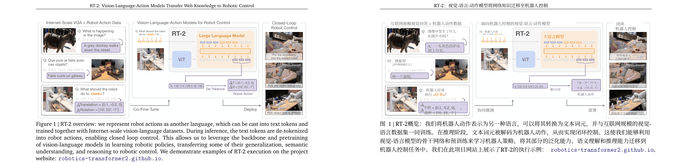
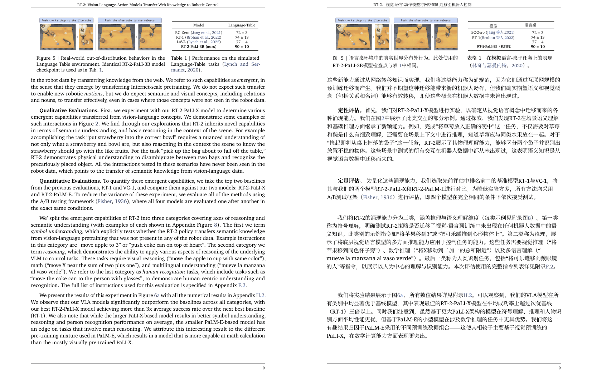

# Production notes

[中文](production-notes.zh-CN.md)

Paper Translator was split out of a personal site, where it translated real papers for a small group of users through the second half of 2026. That site runs on a 2 vCPU / 4 GB cloud server alongside a few other services. This page records what the output looks like, what went wrong in production, and what was changed because of it. It is written for anyone deciding whether to self-host, especially on a small machine.

The site's build is close to this repository but not identical. [Production and this repository](#production-and-this-repository) lists the differences.

## What the output looks like

The screenshots are from a real production run: *RT-2: Vision-Language-Action Models Transfer Web Knowledge to Robotic Control* ([arXiv:2307.15818](https://arxiv.org/abs/2307.15818), © 2023 Google DeepMind). It was translated in September 2026 with BabelDOC 0.6.2 and the site's default chat model, then downloaded as the bilingual PDF (original page on the left, translation on the right). The excerpts below are cropped from that file to show the output. They are not a translation of the paper; read the original on arXiv.

### Title page and abstract

- The title, author list, affiliation line and abstract are translated in place, and the fonts and line spacing stay close to the original.
- Author names were transliterated into Chinese. Some readers would rather keep Latin names; nothing in the pipeline enforces either choice yet.
- The two-line header on the right ran together: the date was appended to the project URL ("…github.io2023年8月1日"). Small header and footer blocks are the most fragile part of the layout.

### Figures

- Text inside vector figures is translated too: panel titles, Q/A bubbles, "Co-Fine-Tune", "De-Tokenize" and "Deploy" all became Chinese. Raster images are left alone (the separate image translator handles those).
- Labels in tight boxes get cramped. The ΔT/ΔR action vector lost its layout and some photo captions overlap the image. If a figure matters, check it against the original.
- The caption is complete and reads naturally. The URL in it was kept as it was.

### A body page with a table

- Running text, section headings ("定性评估", "定量评估") and inline citations translate well. Citations keep their Latin author names ("Fisher, 1936").
- Table 1 lost a row: "LAVA (Lynch et al., 2022)" disappeared and its score "77 ± 4" sits under RT-1. Short table cells are where BabelDOC most often drops or merges text, so treat numbers in translated tables with care.
- The table caption transliterated the citation "Lynch and Sermanet, 2020" into Chinese while the body text did not. Consistency across captions and body text is not guaranteed.

### What was not translated

Pages 13–26 of this paper are references followed by appendices, and all of them stayed in English. References are left in the original language on purpose. The appendices should have been translated, and they were not, for two reasons:

1. This run happened before the appendix rules existed (they were added in October 2026).
2. Even with the current rules, RT-2's appendix headings ("A. Contributions", "B. Datasets", …) are not recognized. Only "Appendix …", keyword headings such as "Supplementary Material" or "Acknowledgements", and titled variants are. See [Known issues](#known-issues).

## Speed and memory on 2 vCPU / 4 GB

These numbers were measured on the production server with one-page chunks. Each page was run at three concurrency settings, interleaved so that cache and network conditions were comparable.

| Requests in flight (qps) | Translation stage per page | Whole page, end to end |
| --- | --- | --- |
| 2 | 26.3 s | about 51 s |
| 4 (site default) | 15.4 s | about 40 s |
| 6 | 13.1 s | about 38.5 s |

- About 20 s per page is spent before any text is sent to the model. Starting Python and importing BabelDOC takes about 7.7 s. Layout and formula parsing takes about 12 s, and every page pays it.
- Above qps 4 the gain is small, because the fixed per-page work dominates.
- The BabelDOC process peaked at 2.1–2.5 GB proportional set size (PSS), independent of qps. The lowest available memory, 380–770 MiB, came during layout, not during translation.
- The provider returned no rate-limit (429) responses during the test.

## Problems we hit and what changed

Each entry gives the symptom, the cause, and where the fix lives. "In this repo" means the released code already contains it. "Production only" means the site has it and this repository does not yet.

### 1. Memory: the hardest part on a 4 GB machine

| Symptom | Cause | Change |
| --- | --- | --- |
| The whole backend froze. Load average reached about 26, health checks timed out and SSH dropped. | The systemd `MemoryHigh` limit (2200 MB) was below the app's own memory guard, so the kernel throttled the entire service before the app could stop BabelDOC. | Set systemd limits above the app guard. The site now uses `MemoryHigh=2700M`, `MemoryMax=2800M` and `MemorySwapMax=1200M`. |
| Valid runs were killed at 2404 and 2522 MiB. | A 2400 MiB guard is below BabelDOC's normal peak, which is about 2.6–2.8 GB for document work. | Raised the guard. Lowering the qps does not lower this peak. |
| Runs failed although the process was not that large. | The guard read `memory.current`, which counts file cache from earlier chunks. | Measure the working set instead: `memory.current − inactive_file`. **In this repo.** |
| Available memory dropped to 53 MiB and the hard limit killed the run. | `vm.swappiness=0`, so swap was never used. | `vm.swappiness=20` plus a per-service swap cap. |
| A three-page chunk still peaked too high. Cutting chunks from 5 pages to 3 did not help. | The peak comes from per-page layout work. Chunk size only moves it around. | Fixed one-page chunks on 4 GB hosts. Under pressure, concurrency steps down 4 → 2 → one page at a time. **In this repo** (the default is one page per chunk). |
| After a month of uptime, runs were refused because "swap is full". | Whole-machine swap included cold pages from other services. | Count the service's own swap (`memory.swap.current`) and keep only a 256 MiB floor on system-wide free swap. **In this repo.** |

If you run on a small host, keep the app guard below the systemd limits, keep some swap, and test with a real multi-page PDF. A short test document will not reach the peak.

### 2. Tokenizer download at task start

- **Symptom:** the first chunk failed with a TLS EOF before any page was translated.
- **Cause:** BabelDOC uses tiktoken, which downloads `o200k_base` from Azure the first time it is needed, and that network path was unreliable from the server. Importing BabelDOC also overrode the cache directory that had been set.
- **Change:** the tokenizer file ships with the app, its SHA-256 is checked before use, and the runner restores the cache directory after BabelDOC is imported. **In this repo** (`backend/scripts/tiktoken-cache/`). When upgrading BabelDOC or tiktoken, check that the source URL, cache key and hash still match.

### 3. An unattended Java upgrade broke translation, and health still returned 200

- **Symptom:** tasks failed at 0% with "Incorrect Java version" and a `jspawnhelper` version mismatch, while `/api/health` kept returning 200.
- **Cause:** unattended-upgrades replaced the JDK under a JVM that was still running. The old JVM could no longer start subprocesses, and the translator starts every run as a Python subprocess.
- **Change (operations):** exclude OpenJDK from unattended upgrades. Upgrade Java by hand when no task is running, restart the service, and then run one real translation. A health check alone does not prove the worker can start BabelDOC.

### 4. Scanned PDFs

| Symptom | Change |
| --- | --- |
| BabelDOC reported "no paragraphs" on a 12-page scanned paper. | Pages without a text layer go through Tesseract OCR first. The page becomes a background image (at most 300 DPI) with a hidden text layer on top. **In this repo.** |
| The translation came out at about 63% of the original text size. | Hidden text is sized from the measured glyph height (÷ 0.86) and calibrated per page against the actual strokes. |
| One paragraph broke into 92 pieces. | Hidden text is written in reading order, so a two-column page yields 12 whole paragraphs instead. |
| Black boxes appeared over citation numbers, and logos and covers were garbled. | Embedded images smaller than half a page (logos, covers, figures) are not OCRed. |

### 5. References and appendices

- **Symptom:** appendices after the bibliography stayed in English, and the task still finished as "completed".
- **Cause:** once the references section starts, every later block is kept in the original language until a heading ends the section. At first only a bare "Appendix" line counted as such a heading.
- **Changes:**
  - Numbered and titled appendix headings, plus Supplementary / Supporting / Methods / Acknowledgements, now end the references. **In this repo.**
  - A running-title prefix such as "GraspGen-X: Supplementary Material" is also accepted. **In this repo.**
  - Chunks cached before the fix have to be invalidated. Bumping the cache version did not do it, because the compatibility check ignores the `version=` line. A separate policy line (`references=titled-appendix-v1`) is used instead.
- **Still open:** bare letter headings ("A", "A. Contributions"). See [Known issues](#known-issues).

### 6. Never deliver a half-translated PDF

| Symptom | Change |
| --- | --- |
| BabelDOC swallowed provider errors, so the "translated" PDF was the original and the user was charged. | Any provider failure marks the run as incomplete, and no PDF is delivered (`fail_closed`). **In this repo.** |
| Some paragraphs came back empty or cut off. | Retry with larger output budgets (4096 → 8192 → 16384 tokens) before giving up. **In this repo.** |
| The provider retired a model, and every request returned HTTP 400. | The settings page has a **Test connection** button, and `paper-translator doctor` checks the model before you wait on a real run. **In this repo.** |
| A revoked or expired API key returns 401 on every page. | Thanks to `fail_closed`, the task ends as failed and is not delivered as a translation. Check the key with **Test connection**. |

### 7. A reasoning model used its whole output budget on thinking

- **Symptom:** a chunk sat for about 10 minutes and then failed. The model returned an empty answer with `finish_reason=length`.
- **Cause:** the provider's v2.6 model reasons by default. For a 923-token paragraph it spent all 4096 output tokens on reasoning, and the same happened at every larger budget.
- **Change:** turn reasoning off for that provider's models (`thinking: {"type": "disabled"}`) and include that flag in the translation cache key. **Production only.** If your provider reasons by default, turn reasoning off or use a non-reasoning model.

### 8. A rejected batch failed the whole document

- **Symptom:** a document failed even though every paragraph eventually translated.
- **Cause:** BabelDOC sends paragraphs in JSON batches and falls back to one paragraph per request when a batch is rejected. The completeness check marked the document incomplete as soon as the batch was rejected, so a successful fallback did not help.
- **Change:** only a failure on the final per-paragraph request marks the document incomplete. The runner's error message now includes the reason. **Production only.**

### 9. A few kept-source paragraphs should not fail a 30-page paper

- **Symptom:** a long paper failed because a handful of paragraphs were still in English after every retry.
- **Change:** tolerate at most 3 untranslated paragraphs and at most 2% of the document, as long as no page is entirely untranslated. The task then finishes with a warning that lists the affected pages, and per-chunk counts are written to `paragraphs.json`. Anything beyond that still fails. **Production only.**

### 10. Temporary files from killed runs

- **Symptom:** the server's disk dropped to 448 MB free.
- **Cause:** 59 BabelDOC working directories, each holding a copy of the uploaded PDF, were left in `/tmp` by runs that the memory guard had killed.
- **Status:** cleaned up by hand. **Still open:** the service does not yet sweep these directories.

### 11. CI and packaging

- macOS runners moved to Python 3.15, which has no onnxruntime wheel. The BabelDOC command now pins `--python 3.12`.
- Windows checkouts converted the tokenizer file's line endings and broke its hash. `.gitattributes` marks it as binary.
- The release archive link check failed on Windows paths. Archive paths are now checked in POSIX form on every platform.

### 12. Image translation boxes

Vision models give only approximate text boxes, so covers either missed parts of the original text or covered nearby artwork. Each box is now snapped to the actual strokes before it is covered (`TextBoxRefiner`). **In this repo only.** The site still runs the older image path.

## Known issues

- **Lettered appendix headings are not recognized.** Headings like "A. Contributions" or a bare "A" followed by a title line leave the appendix in English, and the task still reports success. The page contains no translatable paragraphs, so the "no fully untranslated page" check does not fire. This affects both the site and this repository.
- **Tables:** short cells can be dropped or merged (see RT-2 Table 1 above).
- **Small labels in figures** can overlap or lose their layout.
- **Names:** author names may be transliterated in some places and kept in Latin script in others.
- **OCR** sometimes misreads symbols, for example ε0 as "¢9". A citation marker can overlap the translated text, and a white block can appear inside grey page headers.

## Production and this repository

| Area | Site | This repository |
| --- | --- | --- |
| Accounts, credits, refunds | Yes | Removed |
| Memory guard thresholds | Tuned for that host | Same logic. Defaults: working-set guard 2850 MiB, 400 MiB minimum available, 1200 MiB service swap. The memory limit can be changed in the manual performance tier |
| Settings page, performance tiers, CLI | No (environment variables and an admin panel) | Yes |
| Reasoning disabled for reasoning-by-default models | Yes | Not yet |
| Batch-fallback fix (item 8) | Yes | Not yet |
| Kept-source tolerance with warning (item 9) | Yes | Not yet |
| Image text-box snapping (item 12) | No | Yes |
| Lettered appendix headings | Not fixed | Not fixed |

The three "not yet" rows are planned for a future release.
